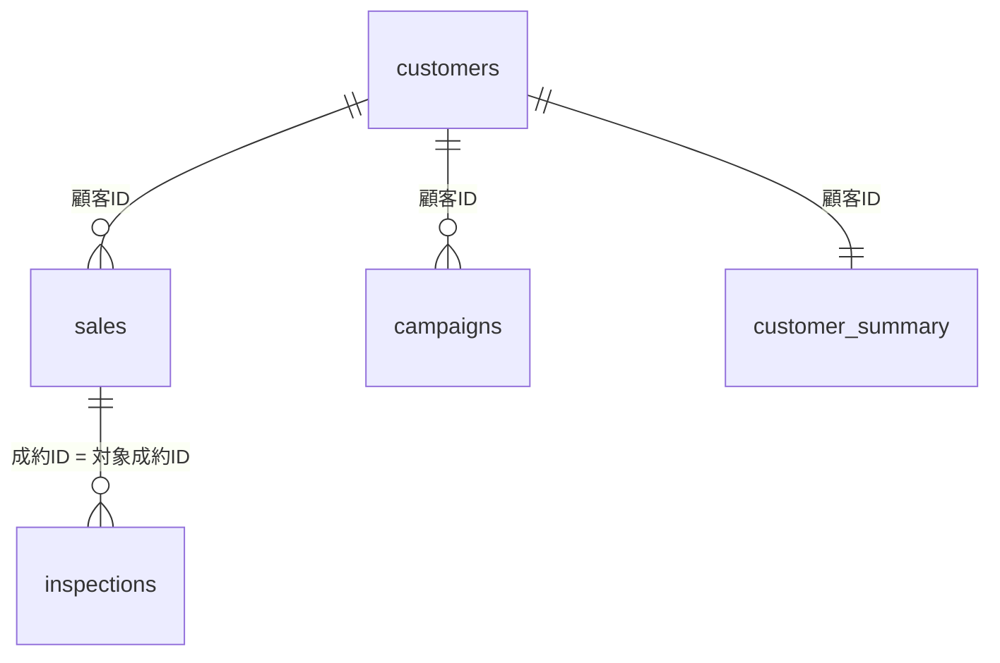

# 中古車CRM 練習用データセット（Used-Car Dealership CRM Practice Dataset）

中古車販売店の CRM（顧客管理）を模した、分析練習用の**架空のデータセット**です。顧客・成約・車検や点検の入庫・施策（電話・LINE などのアプローチ）の5つの表を `顧客ID` でつなぎ、リテンション分析（再来店）と施策の効果測定を練習できます。Salesforce のオブジェクト構成（Contact / Opportunity / Campaign など）にならっています。

[](LICENSE)

-475569)

> **English summary:** A synthetic CRM dataset of a fictional used-car dealership chain (7 stores in the Kanto region of Japan), designed for practicing retention (RFM, cohort, churn prediction) and campaign-effectiveness analysis. Five CSV tables modeled after Salesforce objects (Contact, Opportunity, a custom inspection object, Campaign) are linked by `顧客ID` (customer ID), with an analysis-ready one-row-per-customer summary. Snapshot date: 2026-07-01. All data, including customer names, is fictional.

> [!IMPORTANT]
> すべて**擬似（架空）データ**です。氏名を含め、実在の人物・顧客・車両とは関係ありません。分析の練習・学習のために使ってください。

## 目次

- [データの概要](#データの概要)
- [すぐに始める](#すぐに始める)
- [テーブルの関係](#テーブルの関係)
- [列の定義](#列の定義)
- [練習課題](#練習課題)
- [仕込まれたシグナルのヒント](#仕込まれたシグナルのヒント)
- [Salesforce で再現するとき](#salesforce-で再現するとき)
- [ライセンス](#ライセンス)

## データの概要

| 項目 | 内容 |
|---|---|
| 分析の基準日（スナップショット） | 2026-07-01 |
| データの期間 | 2021年1月〜2026年7月1日 |
| 舞台 | 関東の7店舗（つくば・世田谷・千葉・大宮・宇都宮・横浜・高崎） |
| ファイル形式 | CSV（UTF-8・BOM 付き、改行 CRLF）。Excel でダブルクリックしても文字化けしません |

| ファイル | 1行の単位 | Salesforce での対応 | 行数 |
|---|---|---|---:|
| [`customer_summary.csv`](customer_summary.csv) | 1顧客 | 集計ビュー（分析用） | 3,000 |
| [`customers.csv`](customers.csv) | 1顧客 | 取引先責任者（Contact） | 3,000 |
| [`sales.csv`](sales.csv) | 1成約（車両販売） | 商談（Opportunity、フェーズ＝成約） | 3,303 |
| [`inspections.csv`](inspections.csv) | 1整備予定（車検・点検） | カスタムオブジェクト | 14,408 |
| [`campaigns.csv`](campaigns.csv) | 1接触（アプローチ） | キャンペーン／キャンペーンメンバー／活動 | 14,800 |

まずは **`customer_summary.csv`**（1顧客1行に集約した分析用の表）から触るのがおすすめです。

## すぐに始める

1. このページの上にある緑色の **［Code］** ボタン → **［Download ZIP］** でダウンロードし、展開します。
2. 使い慣れたツールで CSV を読み込みます。

**Python（pandas）**

```python
import pandas as pd

summary = pd.read_csv("customer_summary.csv", encoding="utf-8-sig",
                      parse_dates=["初回成約日", "最終来店日", "最終接触日"])
print(len(summary))                    # 3000
print(summary["再来店フラグ"].mean())   # 0.762（アクティブ顧客の割合）

# 成約に顧客の属性をつなぐ
customers = pd.read_csv("customers.csv", encoding="utf-8-sig")
sales = pd.read_csv("sales.csv", encoding="utf-8-sig", parse_dates=["成約日"])
sales_with_customer = sales.merge(customers, on="顧客ID", how="left", suffixes=("", "_顧客"))
```

**Excel / Power BI**

- Excel：CSV をダブルクリックで開けます（BOM 付きの UTF-8 なので、日本語は文字化けしません）。複数の表をつなぐときは［データ］→［テキストまたは CSV から］で取り込みます。
- Power BI Desktop：［データを取得］→［テキスト/CSV］で5つの表を取り込み、`顧客ID`（と `成約ID`＝`対象成約ID`）でリレーションシップを作ります。

## テーブルの関係



- `sales`・`inspections`・`campaigns` の `顧客ID` は、すべて `customers` に存在します。
- `inspections` は、もとになった成約に `対象成約ID` でつながります（`顧客ID` も持っています）。
- `customer_summary` は、ほかの4つの表を1顧客1行に集約した表です。

## 列の定義

### customers.csv（顧客マスタ）

| 列 | 説明 |
|---|---|
| 顧客ID | 主キー（C00001〜C03000） |
| 氏名 | 架空の氏名 |
| 性別 / 年齢 / 年代 | 顧客の属性（年代は 20代〜70代） |
| エリア / 担当店舗 | 関東の7都県と、それぞれの担当店舗 |
| 会員登録日 | |
| 流入経路 | 中古車ポータル / 自社Web / 店舗来店 / 紹介 / SNS |
| LINE登録 | 登録 / 未登録（若い年代ほど登録率が高い） |
| メール配信可否 | 可 / 不可 |
| 満足度 | 1〜5（納車時アンケートを想定） |

### sales.csv（成約＝車両販売）

| 列 | 説明 |
|---|---|
| 成約ID | 主キー（S00001〜） |
| 顧客ID | → customers |
| 成約日 / メーカー / 車種 / ボディタイプ / 年式 | ボディタイプは 軽・コンパクト・セダン・ミニバン・SUV |
| 車両価格 / 走行距離km | |
| 支払方法 / 下取り | 現金・ローン / 有・無 |
| 担当店舗 | |
| 購入区分 | 初回 / リピート（＝2台目の再購入） |

### inspections.csv（車検・整備の予定と来店実績）

| 列 | 説明 |
|---|---|
| 整備ID | 主キー（I00001〜） |
| 顧客ID / 対象成約ID | つなぐためのキー |
| 種別 | 車検（24か月周期）/ 12ヶ月点検 / オイル交換・点検 |
| 予定日 | 入庫の予定日 |
| **来店実施** | 実施 / 未実施　← **再来店の実体** |
| 実施日 | 来店した場合のみ（未実施は空欄） |
| 整備売上 | 実施したときの売上（車検は高単価。未実施は 0） |

### campaigns.csv（施策の接触履歴＝アプローチ）

| 列 | 説明 |
|---|---|
| 接触ID | 主キー（T00001〜） |
| 顧客ID | → customers |
| 施策目的 | 車検案内 / 点検案内 / 乗り換え提案 / イベント・セール案内 |
| 接触日 | |
| **チャネル** | 電話 / メール / LINE / SMS / DM(郵送) |
| **オファー** | 無料点検 / 車検早割 / 割引クーポン / 下取りUP / なし |
| **車検までの月数** | 接触のタイミング（1〜6、小さいほど直前）。車検案内・点検案内のときだけ入っています |
| 反応 | 済（反応あり）/ 未 |
| 施策カテゴリ | 車検・点検リマインド / アップセル / 来店促進 |

### customer_summary.csv（分析用・1顧客1行）

| 列 | 説明 |
|---|---|
| 顧客ID / 年代 / 性別 / エリア / 担当店舗 | 属性 |
| 初回成約日 / 初回成約コホート月 | コホート分析用（コホート月は YYYY-MM） |
| 累計成約台数 / 累計車両売上 / 累計整備売上 / **総売上LTV** | 金額（Monetary） |
| 来店回数 | 成約＋整備来店の合計（Frequency） |
| 最終来店日 / **最終来店からの経過日数** | Recency |
| 最終再来店からの経過月数 | 初回成約を除いた、直近の来店からの月数（再来店がない顧客は空欄） |
| 最終接触日 / 施策接触回数 / 施策反応率 / 主要チャネル | 施策側の指標（接触がない顧客は空欄） |
| 満足度 | |
| 整備予定件数 / 来店実施件数 / **車検点検実施率** | 入庫の定着度（整備予定がない顧客は空欄） |
| これまでの再来店有無 | 1＝初回以降に一度でも来店 |
| **再来店フラグ** | **1＝直近18か月に再来店（＝アクティブ顧客）**　← 主な予測ターゲット |
| 再購入フラグ | 1＝2台目を購入 |

## 練習課題

この順番で進めると、力がつきます。

1. **EDA（探索的データ分析）**：`来店回数` や `最終来店からの経過日数` の分布、コホート月別の顧客数を見る。
2. **RFM 分析**：`最終来店からの経過日数`（R）/ `来店回数`（F）/ `総売上LTV`（M）を各5分位でスコア化し、優良層・離脱予備層を定義する。中古車は購入の頻度が低いので、F の代わりに `車検点検実施率` を軸にする工夫も試す。
3. **コホート分析**：`初回成約コホート月` × 経過月で、`再来店フラグ` の推移（リテンションカーブ）を描く。
4. **施策の効果測定（本命）**：`campaigns.csv` を使い、チャネル別・オファー別・`車検までの月数` 別の**反応率**を比べる。さらに「接触あり群 vs なし群」で `来店実施` の率を比べ、**リフト（効果量）** を出す。
5. **セグメンテーション**：k-means などで顧客を4〜6のクラスターに分け、クラスターごとに合うアプローチを提案する。
6. **再来店の予測**：`customer_summary.csv` を学習データにして、`再来店フラグ` をロジスティック回帰や決定木で予測し、効いた変数（特徴量の重要度）を解釈する。
7. **示唆出し**：「だれに・いつ・どのチャネルで・どのオファーを送るべきか」を1枚にまとめる。

## 仕込まれたシグナルのヒント

答え合わせのための「方向」だけを示します。実際の効果量（% やリフト）は、自分で分析して確かめてください。

- **施策のタイミング**：車検の直前（1〜3か月前）ほど反応しやすい。
- **チャネル × 年代**：LINE は若い年代、電話は中高年で反応がよい傾向。
- **オファー**：無料点検・車検早割が反応に効きやすい。
- **満足度・流入経路**：満足度が高い顧客、紹介で来た顧客は、リテンションが高い。
- **離脱とウィンバック**：一度整備の入庫が離れた顧客は戻りにくいが、強いオファーの接触で一部は戻ってくる。

## Salesforce で再現するとき

- `customers` → 取引先責任者（Contact）、`sales` → 商談（Opportunity、フェーズ＝成約）、`campaigns` → キャンペーン＋キャンペーンメンバー、`inspections` → カスタムオブジェクト。
- データインポートウィザードや Data Loader でこの CSV を取り込み、レポート＆ダッシュボードや CRM Analytics で、上の課題を再現できます。

## ライセンス

[MIT License](LICENSE)
